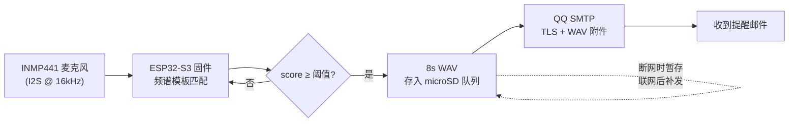

<div align="center">

# ESP32 声音邮件提醒盒子

**Sound Alert · 听到指定声音，就把现场录音发到你邮箱的 ESP32-S3 小盒子**

[](LICENSE)
[](https://www.espressif.com/en/products/socs/esp32-s3)
[](https://github.com/espressif/arduino-esp32)
[](https://platformio.org/)

*无云端 · 无独立服务器 · 无推送会员 · 只依赖你自己的邮箱*

</div>

---

## 这是什么

一个基于 **ESP32-S3** 的声音监听提醒设备：实时监听环境声音，当播放到指定的目标音频（默认 `TRACK01.WAV`）时自动触发，把最近 8 秒的现场录音保存到 microSD，并通过 QQ 邮箱 SMTP 把录音（WAV 附件）发到你指定的邮箱。

每次播放独立触发、独立编号，一分钟响一次就逐次提醒，没有次数上限、没有冷却时间。

**适用场景**：设备放在音响旁，音响播放特定音效/音乐时（比如打卡音乐、提示音），你在手机上立刻收到带录音的邮件提醒。

## 目录

- [功能特性](#功能特性)
- [工作原理](#工作原理)
- [硬件清单](#硬件清单)
- [接线](#接线)
- [快速开始](#快速开始)
- [换成你自己的音频](#换成你自己的音频)
- [阈值校准](#阈值校准)
- [目录结构](#目录结构)
- [已知限制](#已知限制)
- [License](#license)

## 功能特性

| | |
|---|---|
| **离线识别** | 流式频谱模板匹配：24 频带 × 54 帧滑动余弦相似度，静音帧不计入，对音量不敏感，音频不上传 |
| **现场录音** | 触发后保留约 1 秒后摇，最多保存 8 秒 16 kHz / 16 bit 单声道 WAV |
| **可靠投递** | 事件持久化队列 `.ready → .sending → .accepted / .failed / .uncertain`，重启自动恢复，不盲目重发 |
| **TLS 邮件** | QQ 邮箱 465 端口隐式 TLS，证书 + 主机名校验，授权码登录，WAV 附件 |
| **双 WiFi** | `WiFiMulti` 自动连接信号强的网络，掉线自动重连（仅 2.4GHz） |
| **空间保护** | microSD 剩余低于 16MB 停止写入，不静默覆盖未发送事件 |
| **并发架构** | 采集 / 存储 / 发送三任务分核运行，邮件阻塞不影响采音 |

## 工作原理



## 硬件清单

| 部件 | 要求 | 数量 |
|---|---|:---:|
| ESP32-S3 开发板 | **N16R8**：16MB Flash + 8MB PSRAM，带 USB-C | 1 |
| 数字麦克风 | I2S 输出、3.3V 供电，如 INMP441 模块（6 脚） | 1 |
| microSD 读卡模块 | SPI 接口，支持 3.3V 逻辑与供电 | 1 |
| microSD 卡 | 8–32GB，FAT32，建议耐写卡 | 1 |
| USB-C 数据线 / 5V 电源 | 烧录 + 供电 | 1 |

> [!WARNING]
> - 板子必须核对金属罩丝印为 `ESP32-S3-WROOM-1-N16R8`，普通 `ESP32-WROOM-32` 或没有 8MB PSRAM 的板子跑不了
> - 麦克风必须是 6 脚 I2S 数字麦，3 脚模拟麦不能用

## 接线

**断电操作。** 板子的 3V3 通常只有一个针脚，两个模块共用一个 3V3 时用「一分二杜邦线」或面包板电源轨分出两路。

| 模块 | 引脚 | ESP32-S3 |
|---|---|:---:|
| 麦克风 | VDD | 3V3 |
| 麦克风 | GND | GND |
| 麦克风 | SCK / BCLK | GPIO4 |
| 麦克风 | WS / LRCLK | GPIO5 |
| 麦克风 | SD / DOUT | GPIO6 |
| 麦克风 | L/R | GND（选左声道） |
| 读卡模块 | VCC | 3V3 |
| 读卡模块 | GND | GND |
| 读卡模块 | SCK | GPIO12 |
| 读卡模块 | MISO | GPIO13 |
| 读卡模块 | MOSI | GPIO11 |
| 读卡模块 | CS | GPIO10 |

> [!IMPORTANT]
> - 麦克风的 `SD` 是数据脚，**不是** SD 卡
> - 麦克风 VDD 只接 3V3，**不接 5V**
> - 读卡模块必须支持 3.3V 供电（丝印只有 5V 的勿用，会往 GPIO 灌 5V）
> - GPIO19 / GPIO20 是 USB 专用，不要接

## 快速开始

### 1. 准备配置

```bash
cp include/secrets.example.h include/secrets.h
```

编辑 `include/secrets.h`：

| 字段 | 说明 |
|---|---|
| `WIFI_SSID` / `WIFI_PASSWORD` | 2.4GHz WiFi（不支持 5GHz） |
| `WIFI_SSID_2` / `WIFI_PASSWORD_2` | 可选第二个 WiFi，留空则禁用 |
| `SMTP_USER` | 发件 QQ 邮箱 |
| `SMTP_AUTH_CODE` | 16 位授权码（**不是** QQ 密码） |
| `MAIL_FROM` | 必须和 `SMTP_USER` 相同 |
| `MAIL_TO` | 收件邮箱，可和自己相同 |
| `MAIL_ENABLED` | 先保持 `false`，硬件通过后改 `true` |

> QQ 邮箱授权码：邮箱设置 → 账号 → 开启 IMAP/SMTP 服务 → 手机短信验证 → 生成 16 位授权码。

### 2. 编译烧录

需要 [PlatformIO](https://platformio.org/)（含 espressif32 工具链）。本工程锁定 `espressif32@6.12.0` / Arduino-ESP32 2.0.17。

```bash
pio run
pio run -t upload --upload-port COM8   # COM 号换成你的
pio device monitor -b 115200
```

固件默认把日志输出到**原生 USB 口**（`ARDUINO_USB_CDC_ON_BOOT=1`），串口监视器要接板子上标 `USB` 的口；`UART`/`COM` 口只用于烧录。想把日志改到 UART 口时，把 `platformio.ini` 里这行改成 `=0` 重新编译。

> [!TIP]
> Windows 下如果工具链路径很长，GCC 内部命令行可能超过 32K 上限，报 `CreateProcess: No such file or directory`。把工程放到较短路径再编译即可。

### 3. 串口命令

| 命令 | 作用 |
|:---:|---|
| `s` | 状态：检测数 / 已入队 / SMTP 接受数 / 不确定数 / 溢出数 / WiFi / 时钟 / 剩余 PSRAM |
| `t` | 手动触发一次测试事件（保存录音，配置完整时发信） |
| `c` | 删除已被 SMTP 接受的本地录音 |

### 4. 首次测试顺序

1. 烧录后看启动三关：PSRAM → microSD → I2S 麦克风，全过会打印 `mail_enabled=0`
2. 保持 `MAIL_ENABLED=false`，播放目标音频，串口应出现 `DETECTED` 和 `QUEUED`
3. 改成 `true` 重编，播放一次，确认手机收到带 WAV 附件的邮件

## 换成你自己的音频

默认模板来自 `TRACK01.WAV`（音频文件不入库）。用自己的音频重新生成模板：

```bash
python tools/make_template.py path/to/your.wav
```

要求：16 位 PCM WAV，采样率 48000 或 16000 Hz，左右声道基本一致（脚本会检测相位抵消）。脚本会生成 `assets/reference-16k.wav`、`assets/template.npy`，并重写 `include/reference_template.h`，重新编译即可。

## 阈值校准

阈值在 `secrets.h` 的 `MATCH_THRESHOLD`。默认 0.91 是离线初始值，**实测环境建议从 0.72 起调**：

1. 让音响按真实音量播放目标音频若干次，记录串口 `DETECTED ... score=...` 的最低分
2. 播放常见干扰声（其他音乐、说话声），记录最高分
3. 把阈值设在两者之间

> [!NOTE]
> 音响音量、距离、房间混响、变速都会影响分数，换环境要重新校准。

## 目录结构

```
sound-alert/
├── src/main.cpp              设备固件（采集/识别/存储/发送 三个任务）
├── include/
│   ├── detector.h            流式匹配检测器
│   ├── reference_template.h  频谱模板（make_template.py 生成）
│   ├── smtp_session.h        SMTP/MIME 客户端
│   ├── smtp_ca.h             QQ 邮箱 CA 证书
│   ├── delivery.h            投递结果枚举
│   └── secrets.example.h     配置模板（复制为 secrets.h）
├── tools/
│   ├── make_template.py      从 WAV 生成模板（需 numpy）
│   ├── verify_detector.py    调用同一检测模块跑离线测试
│   └── fetch_smtp_ca.py      刷新 SMTP 服务器 CA
├── tests/                    桌面 C++ 测试源码（不属于固件）
├── assets/                   template.npy（WAV 不入库）
└── platformio.ini
```

## 已知限制

- 只支持 2.4GHz WiFi；SMTP 仅验证过 QQ 邮箱（smtp.qq.com:465）
- 免费邮箱有频率与每日额度，全天每分钟一封不一定可行，需用自己的账号实测
- SMTP 提交后确认丢失时可能重复投递（协议本身限制，见 [RFC 5321](https://datatracker.ietf.org/doc/html/rfc5321/)）；同一事件编号只代表同一件事
- 正在采集或写卡中的事件断电可能丢失；已写入 `.ready` 的事件重启可恢复
- 本设备不是安防/告警设备，不能替代专用报警系统

## License

<div align="center">

[MIT](LICENSE) © 2026 xuxumidi

</div>
